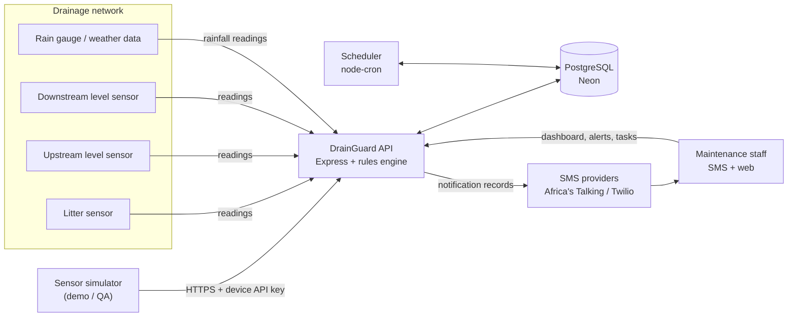
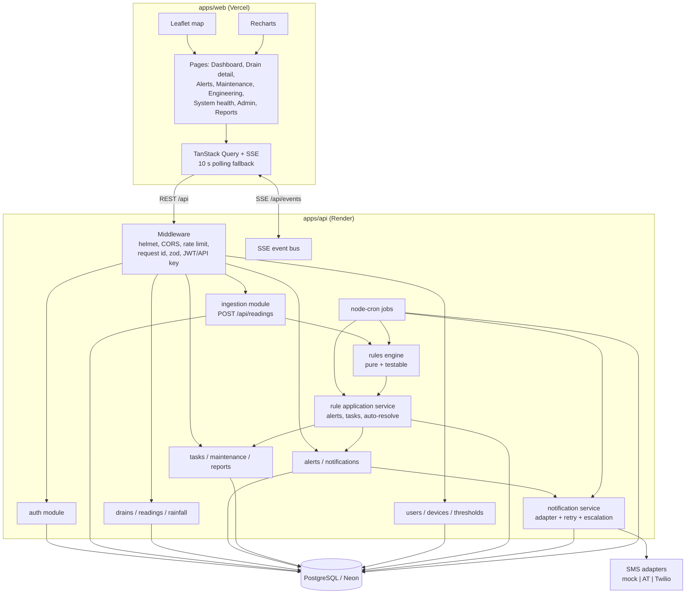
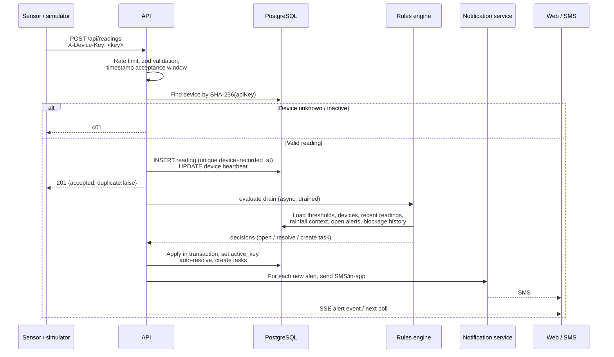
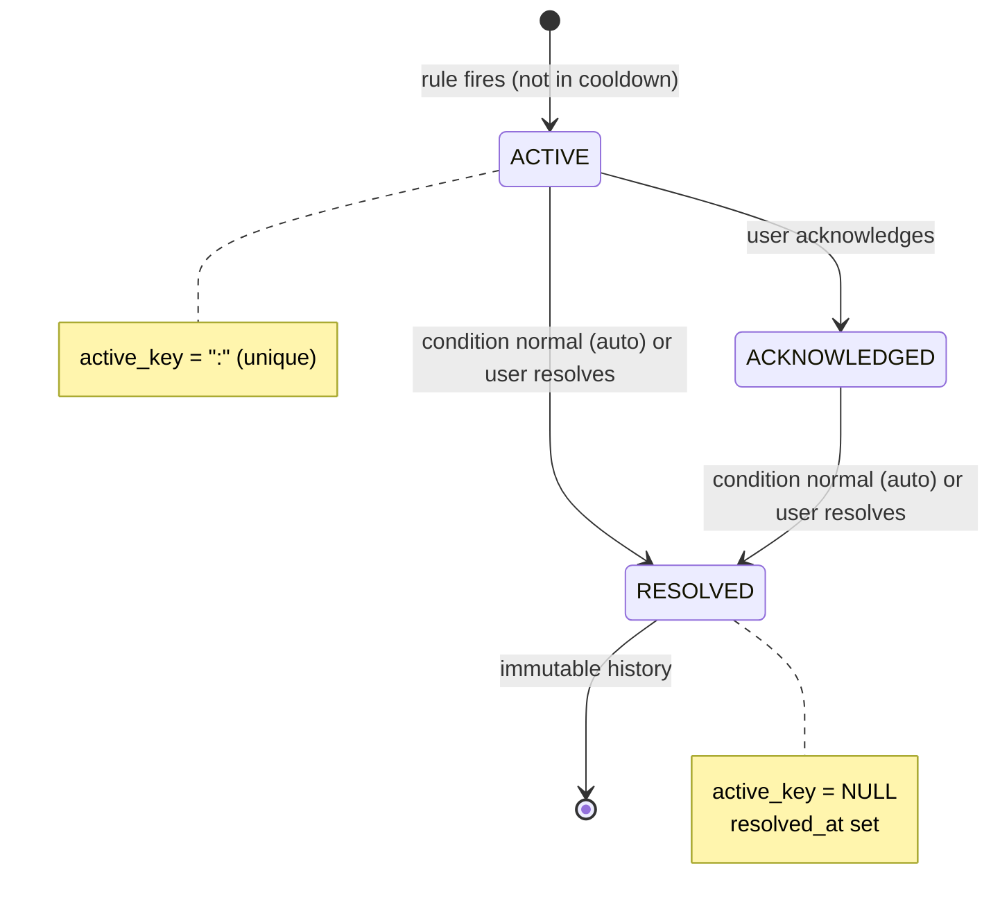
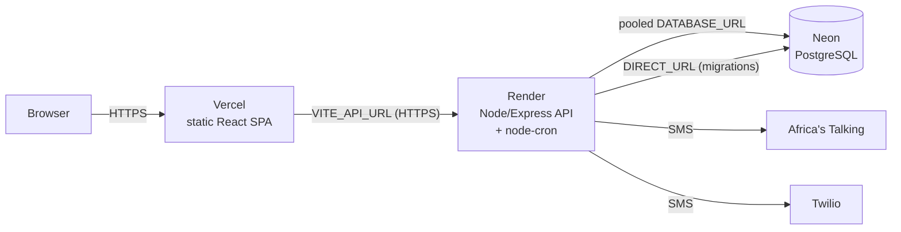

# DrainGuard — Architecture Overview

> DrainGuard connects drainage sensors, monitoring software and maintenance teams to
> support **earlier detection** of drainage problems and **more effective maintenance**.
> It reduces some flood risk but **cannot prevent every flood**. No part of the UI,
> API or documentation should claim otherwise.

Version: 1.0 (complete)
Status: implemented and deployed; see [ASSUMPTIONS.md](./ASSUMPTIONS.md),
[ERD.md](./ERD.md), [API.md](./API.md) and [DEMO.md](./DEMO.md).

---

## 1. Scope

DrainGuard monitors three things at each drain:

1. **Litter accumulation** — fill percentage of the litter basket/trap.
2. **Water levels** — upstream and downstream level in centimetres.
3. **Device health** — whether each sensor node is reporting and healthy.

A deterministic rules engine turns readings into five operational outcomes:

| Condition | System response |
|---|---|
| Basket nearly full | `BASKET_NEARLY_FULL` alert + scheduled litter-removal task |
| Water rising unusually fast | `HIGH_WATER` warning |
| Sustained upstream/downstream level difference | `POSSIBLE_BLOCKAGE` warning + blockage inspection task |
| High water during intense rainfall | `HIGH_WATER` warning; **no automatic blockage alert** |
| Sensor faulty or device offline | `SYSTEM_HEALTH` warning + device-repair task |
| Repeated blockage at the same drain | `ENGINEERING_REVIEW` flag + engineering-investigation task |

Alerts are delivered by SMS (Africa's Talking, Twilio, or a mock/console provider)
to the personnel responsible for the affected drain or zone, with retry and escalation.

### Explicit non-goals for v1

- Predicting or preventing floods. DrainGuard is a monitoring and response-support tool.
- Hydraulic modelling, rainfall forecasting or automated gate/pump control.
- Inbound SMS commands (replies such as `ACK <ref>`); acknowledgement happens in the app.
- Automatic polling of third-party weather APIs. The database and API accept
  `WEATHER_API` rainfall rows, but a weather-vendor integration is out of scope.
- Multi-tenancy, GIS polygons, machine-learning anomaly detection.
- Horizontal scaling of the API beyond one instance (see §11). The data model and
  idempotency rules do not prevent it; the in-process event bus does.

---

## 2. Technology choices

| Layer | Choice | Rationale |
|---|---|---|
| Web client | React 18 + TypeScript + Vite + React Router | Static SPA on Vercel; no server rendering needed for an authenticated operations dashboard. |
| Styling | Tailwind CSS 3 | Fast, accessible component styling with a small runtime. |
| Map | Leaflet + react-leaflet | Mature, free OpenStreetMap tiles, marker clustering available. |
| Charts | Recharts | Declarative SVG charts for level/fill/rainfall overlays. |
| Server state | TanStack Query | Caching, retries, 10 s polling fallback, optimistic mutations. |
| API | Node.js + Express 4 + TypeScript | Small operational surface, easy Render deployment. |
| Validation | Zod | One schema per request, inferred TypeScript types, strict payload checks. |
| Database | PostgreSQL (Neon) + Prisma 6 | Managed Postgres, typed data access, migration history. |
| Auth | JWT access token + rotating refresh token, bcrypt passwords | Stateless API auth with revocable refresh sessions and RBAC. |
| Real time | Server-Sent Events over `fetch` stream | One-way alert/reading events; polling every 10 s is the fallback. |
| Scheduler | node-cron | Offline detection, rule sweep, retries, escalation, token cleanup. |
| SMS | Adapter interface | `mock` for development, `africastalking` and `twilio` for production. |
| Tests | Vitest + Supertest | Fast unit tests for the pure rules engine and API integration tests. |

---

## 3. System context



Rainfall can arrive from a physical gauge (`SENSOR`), an admin (`MANUAL`) or a future
weather integration (`WEATHER_API`). It is stored per zone, not per drain.

---

## 4. Container and component view



### Component responsibilities

| Component | Responsibility |
|---|---|
| `modules/auth` | Login, refresh rotation, logout, `me`; password hashing; JWT issue/verify. |
| `modules/readings` | Device API-key authentication, payload validation, idempotent insert, device heartbeat update, out-of-order handling. |
| `modules/rainfall` | Manual/device/API rainfall ingestion and zone queries. |
| `modules/drains` | Drain CRUD, thresholds, latest readings, per-drain history and aggregates. |
| `modules/alerts` | Filtering, detail, acknowledge/resolve, immutable history, notification status. |
| `modules/tasks` | Task board, assignment, status transitions, maintenance records. |
| `modules/reports` | Alerts per drain, response times, repeat-blockage locations. |
| `modules/system-health` | Device list, last seen, health reason, offline count. |
| `rules/` | Pure rule evaluation: snapshot in, decisions out; no DB or HTTP calls. |
| `services/rule-application.ts` | Loads the snapshot, calls the engine, applies decisions transactionally, emits events. |
| `services/notifications.ts` | Resolves recipients, writes notification rows, sends via adapter, retries. |
| `services/sms/` | `SmsProvider` interface and three implementations. |
| `jobs/` | Offline detection, rule sweep, retry sweep, escalation, token cleanup. |
| `realtime/sse.ts` | In-process event fan-out to authenticated SSE clients. |
| `lib/` | Prisma client, env validation, structured logger, errors, audit writer. |

---

## 5. Data flow

### 5.1 Reading ingestion



Key rules:

- Device authentication uses a random API key (32 bytes). Only its SHA-256 hash and a
  short prefix are stored. The plaintext key is shown once when created or rotated.
- A reading is accepted if `recorded_at` is within `INGEST_MAX_PAST_DAYS` (default 7)
  and not more than `INGEST_MAX_FUTURE_MINUTES` (default 10) ahead of server time.
- Duplicate `(device_id, recorded_at)` or `(device_id, external_id)` inserts are
  treated as idempotent successes (`200`, `duplicate: true`), not errors.
- Out-of-order readings are stored. `device.last_reading_at` only moves forward.
  Rules always read history ordered by `recorded_at`, so late data is incorporated on
  the next evaluation/sweep.
- The reading response is sent after the insert, before rule evaluation completes.
  A rule failure never causes ingestion loss; it is logged and retried by the sweep.

### 5.2 Rule evaluation triggers

1. **After ingestion** — every accepted reading schedules an evaluation of that drain.
2. **Every 60 seconds** — a sweep evaluates all active drains. This catches conditions
   that depend on elapsed time (sustained level difference, heartbeat timeout, rainfall
   context changes) rather than a new reading.
3. **On rainfall ingestion** — schedules evaluation for all active drains in that zone.

Evaluations are coalesced per drain, so a burst of readings produces one run.

### 5.3 Alert lifecycle



- At most **one open alert per drain per condition type**, enforced by the unique
  nullable `alerts.active_key` column. This is the de-duplication mechanism and is
  race-safe at the database level.
- After resolution, a new alert of the same type is suppressed for
  `alertCooldownMinutes` (default 30). The suppressed evaluation is written to the
  audit log with action `ALERT_SUPPRESSED`.
- An acknowledgement does **not** clear the condition. The alert remains open and can
  still auto-resolve. Acknowledgement stops the escalation clock.
- Auto-resolution sets `resolved_at`, `resolution_note`, clears `active_key` and keeps
  the row. Alerts and notifications are never hard-deleted by the API.
- `ENGINEERING_REVIEW` is the exception: it is a manual review flag, not a live sensor
  condition, so it is resolved manually by an engineer/supervisor after findings.

### 5.4 Severity mapping

| Alert type | Severity | Notes |
|---|---|---|
| `HIGH_WATER` | `CRITICAL` | Rising water is the most time-sensitive condition. |
| `POSSIBLE_BLOCKAGE` | `WARNING` | Requires inspection; not proof of a blockage. |
| `BASKET_NEARLY_FULL` | `WARNING` | Planned maintenance. |
| `ENGINEERING_REVIEW` | `WARNING` | Repeated blockages need engineering input. |
| `SYSTEM_HEALTH` | `CRITICAL` when every water sensor on the drain is unusable, otherwise `WARNING` | Faulty/offline device. |

---

## 6. Rules engine

The rules engine is a **pure TypeScript module** (`apps/api/src/rules/`). It receives a
plain snapshot of state and returns decisions. It performs no I/O, which makes every
rule deterministic and unit-testable without a database.

```ts
// Current signatures live in apps/api/src/rules/types.ts.
type RuleInput = {
  now: Date;
  drain: DrainSnapshot;              // id, zone, status, thresholds
  devices: DeviceSnapshot[];         // type, health, lastSeenAt, lastReadingAt
  waterReadings: WaterReading[];     // ordered by recorded_at ascending
  litterReadings: LitterReading[];   // ordered by recorded_at ascending
  rainfall: { latestMmPerHour: number | null; at: Date | null };
  openAlerts: AlertSnapshot[];
  recentBlockageAlerts: { id: string; createdAt: Date; resolvedAt: Date | null }[];
  openTasks: { type: TaskType }[];
};

type RuleDecision =
  | { kind: 'OPEN_ALERT'; type: AlertType; severity: AlertSeverity; rule: string;
      deviceId?: string; triggerData: Record<string, unknown>; message: string;
      createTask?: TaskType }
  | { kind: 'RESOLVE_ALERT'; alertId: string; rule: string; reason: string };
```

### 6.1 Precedence (mandatory)

1. **Device health first.**
   - A device is `FAULTY` if an admin marks it faulty or it reports a reading with
     `quality: "FAULTY"`.
   - A device is `OFFLINE` if `last_seen_at` is older than the drain's
     `heartbeatTimeoutMinutes` (default 10). The offline job persists this state.
   - A device with no successful reading yet is `UNKNOWN`.
   - Readings from `FAULTY`, `OFFLINE` or `UNKNOWN` devices are **excluded from every
     other rule**. If any device is faulty/offline, a `SYSTEM_HEALTH` alert is raised.
   - Healthy devices on the same drain are still evaluated. For rules requiring both
     water sensors, **both** must be healthy; otherwise the rule is skipped.

2. **Rainfall context before blockage.**
   - The latest rainfall row for the drain's zone within `rainfallLookbackMinutes`
     (default 30) is loaded.
   - `intenseRainfall = latestMmPerHour >= intenseRainfallMmPerHour` (default 20 mm/h).
   - When `intenseRainfall` is true, the engine **must not emit a new
     `POSSIBLE_BLOCKAGE` decision**. High water caused by intense rainfall is reported
     as `HIGH_WATER` only. This is the explicit proof that blockage is not assumed
     during heavy rain.
   - Intense rainfall does not suppress `HIGH_WATER`, `BASKET_NEARLY_FULL`,
     `SYSTEM_HEALTH` or `ENGINEERING_REVIEW`, and does not auto-resolve an existing
     blockage alert.

3. **Then the remaining rules.**

### 6.2 Default thresholds

All thresholds live in `drain_thresholds` and are configurable per drain. A drain
without a row receives these defaults (also the column defaults).

| Field | Default | Unit | Meaning |
|---|---:|---|---|
| `basketFillPercent` | 85 | % | Litter fill at/above which removal is scheduled. |
| `waterRiseRateCmPerMin` | 2.0 | cm/min | "Unusually fast" rise. |
| `levelDifferenceCm` | 15 | cm | Upstream minus downstream level that suggests a restriction. |
| `differencePersistMinutes` | 15 | min | How long the difference must persist. |
| `intenseRainfallMmPerHour` | 20 | mm/h | Rainfall context that suppresses new blockage alerts. |
| `rainfallLookbackMinutes` | 30 | min | How recent rainfall must be to count as context. |
| `heartbeatTimeoutMinutes` | 10 | min | No contact for this long ⇒ offline. |
| `repeatBlockageCount` | 3 | count | Blockage alerts within the window that trigger engineering review. |
| `repeatBlockageWindowDays` | 30 | days | Window for repeat-blockage counting. |
| `alertCooldownMinutes` | 30 | min | Suppression after a resolved alert of the same type. |
| `escalationMinutes` | 15 | min | Unacknowledged alert escalation delay. |
| `riseRateWindowMinutes` | 10 | min | Window used to compute rate of rise. |
| `levelMatchWindowMinutes` | 5 | min | Maximum age gap when pairing upstream/downstream readings. |

### 6.3 Rule details

#### Basket nearly full (`BASKET_NEARLY_FULL`)

- Source: the drain's healthy `LITTER` device.
- Latest reading within `heartbeatTimeoutMinutes` must have
  `litterFillPercent >= basketFillPercent`.
- Alert severity `WARNING`; auto-creates a `LITTER_REMOVAL` task (priority `HIGH` at
  ≥ 95 %, otherwise `MEDIUM`), unassigned for a supervisor to allocate.
- Auto-resolves when a healthy litter reading is below the threshold.
- The alert's `trigger_data` records the fill %, threshold, device and reading time.

#### Water rising unusually fast (`HIGH_WATER`)

- Source: healthy `WATER_UPSTREAM` and/or `WATER_DOWNSTREAM` devices.
- For each device, take readings in the last `riseRateWindowMinutes`. Require at least
  two readings spanning **at least 60 seconds** (avoids divide-by-tiny-interval noise).
- `rate = (latest.waterLevelCm - oldest.waterLevelCm) / spanMinutes`.
- If the **maximum** rate across healthy water devices is `>= waterRiseRateCmPerMin`,
  open `HIGH_WATER` (`CRITICAL`), recording the device, oldest/latest levels, span,
  computed rate and threshold.
- Auto-resolves only when all water devices on the drain are healthy and the current
  maximum rate is below the threshold. If a sensor is offline, the alert is left open
  because normality cannot be confirmed.
- During intense rainfall this still fires (high water is still a hazard), with
  `triggerData.rainfall.intense = true`.

#### Possible blockage (`POSSIBLE_BLOCKAGE`)

- Requires **both** water devices healthy, with readings.
- Pair each upstream reading with the nearest downstream reading within
  `levelMatchWindowMinutes`. Unpaired readings are ignored.
- `difference = upstream.waterLevelCm - downstream.waterLevelCm`.
  A positive difference (upstream higher) is the blockage signal.
- The condition is "sustained" when, over the last `differencePersistMinutes`:
  - there are at least **3 valid pairs**,
  - the oldest pair covers at least 90 % of the persistence window,
  - no pair gap exceeds `2 × levelMatchWindowMinutes`, and
  - **every** pair's difference is `>= levelDifferenceCm`.
- If `intenseRainfall` is true, do **not** open the alert. Record a suppressed
  evaluation in the audit log with the context. Existing blockage alerts stay open.
- Otherwise open `POSSIBLE_BLOCKAGE` (`WARNING`) and auto-create an unassigned
  `BLOCKAGE_INSPECTION` task (priority `HIGH`).
- Auto-resolves when both sensors are healthy and the current paired difference is
  below the threshold.

#### Repeated blockage (`ENGINEERING_REVIEW`)

- Count `POSSIBLE_BLOCKAGE` alerts for the drain created within
  `repeatBlockageWindowDays`, excluding alerts created before the most recent resolved
  `ENGINEERING_REVIEW` for that drain.
- If the count is `>= repeatBlockageCount`, open `ENGINEERING_REVIEW` (`WARNING`) once
  and auto-create an unassigned `ENGINEERING_INVESTIGATION` task (priority `HIGH`).
- The alert is **not** auto-resolved by sensor normality. A supervisor/engineer resolves
  it after investigation. This prevents an endless reopen loop after a manual decision.
- Engineers add findings as maintenance records attached to the engineering task; the
  drain detail page shows the full blockage history.

#### Device faulty or offline (`SYSTEM_HEALTH`)

- Open `SYSTEM_HEALTH` when any device is `FAULTY` or `OFFLINE` (and the drain is
  `ACTIVE`). Trigger data lists each affected device, its health, reason, last seen and
  last reading.
- Auto-creates a `DEVICE_REPAIR` task (priority `HIGH`) once per drain while open.
- Auto-resolves when every affected device is `HEALTHY` again.
- `UNKNOWN` devices do not raise alerts until they have been seen once; this prevents
  alert storms while commissioning new hardware.

### 6.4 De-duplication, cooldown and task creation

When the application layer receives decisions:

1. `OPEN_ALERT` uses `active_key = "<drainId>:<type>"`. If a row already exists, the
   open is skipped. A `P2002` unique violation is treated the same way.
2. If no active alert exists, look for the most recent resolved alert of that
   drain/type. If `resolvedAt > now - alertCooldownMinutes`, skip and audit
   `ALERT_SUPPRESSED`.
3. A new alert is inserted with `status = ACTIVE`, `severity`, `rule`,
   `trigger_data`, `message`, `escalation_due_at = now + escalationMinutes`.
4. A task is created only if there is no open (`SCHEDULED` or `IN_PROGRESS`) task of
   the same type for that drain. The task is linked to the alert.
5. Notifications are created for responsible, opted-in staff; sending happens after
   the alert transaction commits.
6. Every action is written to `audit_logs`.

### 6.5 Automatic resolution

| Alert | Auto-resolve when |
|---|---|
| `BASKET_NEARLY_FULL` | Healthy litter reading below threshold. |
| `HIGH_WATER` | All water devices healthy and maximum rise rate below threshold. |
| `POSSIBLE_BLOCKAGE` | Both water devices healthy and current paired difference below threshold. |
| `SYSTEM_HEALTH` | All previously affected devices are healthy. |
| `ENGINEERING_REVIEW` | Never automatic; manual resolution with a note. |

Auto-resolution applies to both `ACTIVE` and `ACKNOWLEDGED` alerts, sets
`resolution_note`, and preserves notification history. The next recurrence after the
cooldown creates a new alert row.

---

## 7. Authentication, authorization and RBAC

### 7.1 Authentication

- **Staff**: `POST /api/auth/login` with email/password → short-lived access JWT
  (15 min default) + opaque refresh token (7 days default, stored hashed).
  Refresh rotates the token; reuse of a revoked token revokes the user's refresh family.
  `POST /api/auth/logout` revokes the presented refresh token. `GET /api/auth/me`
  returns the current profile.
- **Devices**: `X-Device-Key: <plaintext key>` (or
  `Authorization: Device <key>`). The API hashes the key with SHA-256 and looks up
  `devices.api_key_hash`. Keys are generated with `crypto.randomBytes(32)` and shown
  only once. Admin can rotate a key; rotation invalidates the old key immediately.
- **Passwords**: bcrypt with cost 12, minimum 10 characters, never logged.
- **SSE**: the browser connects with a `fetch` stream so the `Authorization: Bearer`
  header can be used. `EventSource` (which cannot set headers) is not used, avoiding
  tokens in URLs. If streaming fails, TanStack Query polls every 10 s.

### 7.2 Role matrix

| Capability | Admin | Supervisor | Technician | Engineer | Device |
|---|:---:|:---:|:---:|:---:|:---:|
| Manage users, contacts, assignments | ✅ | — | — | — | — |
| Manage drains, devices, thresholds | ✅ | — | — | — | — |
| View dashboard / drains / readings | ✅ | ✅ | assigned drains | ✅ | — |
| View all alerts / acknowledge / resolve | ✅ | ✅ | assigned drains | engineering alerts | — |
| View reports | ✅ | ✅ | — | ✅ | — |
| Assign / prioritise / close tasks | ✅ | ✅ | own tasks (status + records) | — | — |
| Log maintenance records | ✅ | ✅ | ✅ | ✅ (findings) | — |
| View engineering investigations | ✅ | ✅ | — | ✅ | — |
| View system health | ✅ | ✅ | ✅ | ✅ | — |
| POST readings / rainfall | — | — | — | — | ✅ |
| POST manual rainfall | ✅ | ✅ | — | — | — |

"Assigned drains" means a matching row in `drain_assignments` (by drain or by zone) or
a task assigned directly to the user. RBAC is enforced in middleware **and** re-checked
in queries scoped to the requesting user; the frontend only hides controls.

---

## 8. Notifications and escalation

### 8.1 Recipient resolution

For an alert on a drain:

1. Active users with `sms_opt_in = true` who have a `drain_assignments` row for the
   drain **or** its zone. This includes technicians and supervisors.
2. If none, the drain's `fallback_contact_id`.
3. If still none, active users with `is_fallback_contact = true`.
4. If still none, `SMS_FALLBACK_PHONE` from the environment.
5. Duplicate phone numbers are collapsed; the same phone receives one SMS.

In-app notifications are recorded for opted-in users regardless of SMS availability.

### 8.2 Message format

```
DrainGuard [HIGH WATER] Drain: <name>, Zone: <zone>. Water rising fast (<x> cm/min). Check now. Ref: <alertId>
```

Other templates:

- Basket: `DrainGuard [BASKET FULL] Drain: <name>, Zone: <zone>. Basket at <x>% (threshold <y>%). Schedule removal. Ref: <alertId>`
- Blockage: `DrainGuard [POSSIBLE BLOCKAGE] Drain: <name>, Zone: <zone>. Upstream is <d> cm above downstream for <m> min. Inspect. Ref: <alertId>`
- Health: `DrainGuard [SYSTEM HEALTH] Drain: <name>, Zone: <zone>. <n> device(s) faulty/offline. Check equipment. Ref: <alertId>`
- Engineering: `DrainGuard [ENGINEERING REVIEW] Drain: <name>, Zone: <zone>. <n> blockages in <window> days. Review. Ref: <alertId>`
- Escalation: `DrainGuard ESCALATION: <original message>`

### 8.3 Retry, fallback and escalation

- Each delivery attempt is a `notifications` row with `attempt`, provider, response and
  status. Rows are written **before** the provider call, so provider outages cannot
  lose the intent.
- Failure retries with exponential backoff (`SMS_RETRY_BASE_MINUTES` × 2^(attempt−1)),
  up to `SMS_MAX_ATTEMPTS` (default 3).
- When primary attempts are exhausted, the fallback contact receives the alert and the
  event is recorded as `kind = ESCALATION` with an explanatory provider response.
- **Unacknowledged escalation**: every alert gets `escalation_due_at`
  (`created_at + escalationMinutes`). A cron job re-sends to fallback contacts if the
  alert is still `ACTIVE` at that time, then sets `escalated_at`. Acknowledgement
  cancels escalation. Escalation never duplicates for the same alert.
- Delivery receipts are not polled in v1. Provider acceptance is recorded as `SENT`;
  `DELIVERED` is reserved for a future status-callback integration. Provider errors are
  stored as `FAILED` with `error` and `provider_response`.
- Users can opt out per channel. SMS opt-out does not suppress in-app alerts.

### 8.4 Provider adapters

```ts
interface SmsProvider {
  name: 'mock' | 'africastalking' | 'twilio';
  send(input: { to: string; message: string }): Promise<{
    providerMessageId: string;
    providerResponse: unknown;
  }>;
}
```

- `mock`: logs the message and returns a synthetic id. Used in development/demo.
- `africastalking`: `POST https://api.africastalking.com/version1/messaging`, `apiKey`
  header, form-encoded `username`, `to`, `message`, optional `from`.
- `twilio`: `POST https://api.twilio.com/2010-04-01/Accounts/{SID}/Messages.json`,
  Basic auth, form-encoded `To`, `From`, `Body`.
- Provider selection is `SMS_PROVIDER`; missing credentials fail fast at startup.
- Phone numbers are validated to E.164 (`+254...`).

---

## 9. Real-time updates

- `GET /api/events` is an authenticated SSE stream. The server emits:
  `alert.created`, `alert.updated`, `reading.created`, `task.updated`,
  `device.health`.
- Events carry minimal IDs and the changed entity; clients invalidate the relevant
  TanStack Query keys and refetch. This keeps the event payload small and lets RBAC
  filtering happen on the normal REST endpoints.
- The SSE hub is an in-process `EventEmitter` with heartbeat comments every 25 s.
- If SSE is unavailable, the client falls back to polling every 10 s. The dashboard
  must remain fully usable without SSE.
- The 60 s rule sweep means steady-state UI updates do not depend on receiving a
  reading event.

---

## 10. Reliability

| Concern | Handling |
|---|---|
| Delayed readings | Accepted up to 7 days late by default; stored with `received_at`; rules use `recorded_at` ordering. Sweep re-evaluates. |
| Duplicate readings | Unique `(device_id, recorded_at)` and `(device_id, external_id)`; duplicate insert returns success with `duplicate: true`. |
| Out-of-order readings | Never overwrite `device.last_reading_at` with an older timestamp; evaluations are recomputed from history. |
| Duplicate alerts | Unique `active_key` per drain/type; application catches `P2002`. |
| Duplicate tasks | Open-task check per drain/type inside the alert transaction. |
| Provider outage | Notification row persisted first; retry job; fallback contact; audit trail. |
| Process crash | All state is in Postgres; scheduler sweep reconstructs conditions; no in-memory rule state. |
| Scheduler overlap | Per-job in-process lock flags; `node-cron` jobs are single-instance. |
| Rule failure | Logged with drain/request id; reading remains stored; next sweep retries. |
| Clock skew | Server time is authoritative for evaluation; future readings > 10 min rejected; stale readings allowed but flagged in trigger data. |

The API never relies on readings being delivered in order or exactly once.

---

## 11. Performance and scale

- Target: dashboard under 3 seconds for 100+ drains on Neon's pooled connection.
- The dashboard endpoint returns summary counts, drain rows and the latest reading per
  device in one request. Latest readings are fetched with PostgreSQL
  `DISTINCT ON (drain_id, type) ... ORDER BY drain_id, type, recorded_at DESC`, backed
  by the composite time-series indexes; no N+1 query per drain.
- History endpoints require `from`/`to` and paginate/aggregate (hour/day buckets) so a
  year of readings is never returned raw. Maximum raw window is 7 days per request.
- Indexes cover: readings by drain/time, by device/time, by drain/type/time; rainfall
  by zone/time; alerts by drain/time, status/severity/time and type/status; tasks by
  status/priority/schedule and assignee/status.
- Connection pooling: runtime uses Neon's pooled URL; migrations use `DIRECT_URL`.
- Rule sweep loads per-drain data in batched queries and processes drains sequentially
  with a small concurrency limit to avoid exhausting the pool.
- SSE is cheap (one connection per open dashboard); the 10 s polling fallback is
  bounded by TanStack Query caching.
- Horizontal scaling would require moving the SSE bus and scheduler locking to shared
  infrastructure (e.g. Redis or Postgres advisory locks). That is documented as a
  scale path, not implemented in v1.

---

## 12. Security

- Helmet security headers; strict JSON body limit (`MAX_READING_BODY_BYTES` for
  ingestion, 1 MB elsewhere).
- CORS allowlist from `CORS_ORIGINS`; credentials are not used (bearer tokens only).
- Rate limits: auth endpoints 10/min/IP, ingestion 120/min/device, other authenticated
  routes 300/min/user; trust proxy enabled for Render.
- Zod validation on every body, query and route parameter. Unknown fields rejected.
- Prisma parameterised queries only; no string-built SQL. The one `DISTINCT ON` query
  uses parameter placeholders.
- Device API keys hashed with SHA-256; passwords bcrypt-hashed; refresh tokens stored
  as SHA-256 hashes.
- JWT contains `sub`, `role`, `type` (`access`/`refresh`), `iat`, `exp`, `jti`; access
  and refresh secrets are different and validated to be at least 32 characters.
- No secrets in source. `.env.example` documents every variable; `.env*` is ignored.
- Audit logging for login success/failure, refresh reuse, alerts opened/resolved,
  acknowledgements, task changes, threshold/device/user changes, and suppressed alerts.
- Logs are structured JSON (pino) with request id, user id and drain id; passwords,
  tokens and API keys are redacted.
- Admin-only device key rotation; plaintext keys are never returned by list endpoints.

---

## 13. Deployment topology



| Concern | Setting |
|---|---|
| Frontend | Vercel static build; `VITE_API_URL` points at the Render API. |
| Backend | Render Web Service; build `npm ci --include=dev && npm run api:build`; start `npm run api:start`. |
| Database | Neon Postgres; pooled URL for runtime, direct URL for migrations. |
| Migrations | Render pre-deploy or one-off command: `npm run db:migrate`; seed with `SEED_PASSWORD` set and `npm run db:seed`. |
| CORS | `CORS_ORIGINS=https://<vercel-app>.vercel.app` (plus preview URLs if needed). |
| Secrets | Render environment variables; never in the repository. |
| Health check | `GET /health` (database ping included). |
| Scheduler | Runs inside the single Render instance; `JOBS_ENABLED=true`. |

Step-by-step setup, deployment and verification are in [README.md](../README.md).
The six-scenario demo is in [DEMO.md](./DEMO.md).

---

## 14. Repository structure

```
DrainGuard/
├── apps/
│   ├── api/                              # Express API
│   │   ├── prisma/
│   │   │   ├── schema.prisma             # data model
│   │   │   ├── migrations/
│   │   │   │   ├── 20260101000000_init/migration.sql
│   │   │   │   └── migration_lock.toml
│   │   │   └── seed.ts                   # demo data
│   │   ├── src/
│   │   │   ├── index.ts                  # HTTP + scheduler bootstrap
│   │   │   ├── app.ts                    # Express app factory
│   │   │   ├── config/env.ts             # validated env
│   │   │   ├── lib/                      # prisma, logger, errors, audit, serializers
│   │   │   ├── middleware/               # auth, rbac, validate, rate limit, errors
│   │   │   ├── modules/
│   │   │   │   ├── auth/
│   │   │   │   ├── users/
│   │   │   │   ├── drains/
│   │   │   │   ├── devices/
│   │   │   │   ├── readings/
│   │   │   │   ├── rainfall/
│   │   │   │   ├── alerts/
│   │   │   │   ├── tasks/
│   │   │   │   ├── reports/
│   │   │   │   └── system-health/
│   │   │   ├── rules/                    # pure engine + condition helpers
│   │   │   ├── services/                 # rule application, notifications, SMS
│   │   │   ├── realtime/                 # SSE hub
│   │   │   └── jobs/                     # cron jobs
│   │   ├── tests/
│   │   │   ├── rules/                    # unit tests for every rule
│   │   │   └── api/                      # Supertest integration tests
│   │   ├── .env.example
│   │   ├── package.json
│   │   └── tsconfig.json
│   └── web/                              # React SPA
│       ├── src/
│       │   ├── app/                      # router, providers
│       │   ├── components/               # layout, ui, theme, map, charts
│       │   ├── features/                 # auth, drains, alerts, tasks, admin, reports
│       │   ├── lib/                      # api client, auth context, SSE, theme, formatters
│       │   ├── pages/                    # 11 pages
│       │   ├── main.tsx
│       │   └── index.css
│       ├── .env.example
│       ├── package.json
│       └── vite.config.ts
├── simulator/                            # six-scenario demo runner
│   ├── src/
│   │   ├── index.ts                      # CLI / interactive scenarios
│   │   ├── scenarios.ts                  # six scenario recipes
│   │   └── client.ts                     # device-key API client
│   └── package.json
├── scripts/                              # install/build helpers
├── docs/
│   ├── ARCHITECTURE.md                   # this file
│   ├── ASSUMPTIONS.md
│   ├── ERD.md
│   ├── API.md                            # HTTP reference
│   └── DEMO.md                           # six-scenario demo guide
├── .gitignore
├── package.json                          # npm workspaces
└── README.md                             # setup, deployment and overview
```

---

## 15. API surface

| Group | Endpoints |
|---|---|
| Auth | `POST /api/auth/login`, `/refresh`, `/logout`, `/change-password`; `GET /api/auth/me` |
| Ingestion | `POST /api/ingest/readings`, `POST /api/ingest/rainfall` (device key) |
| Rainfall | `GET /api/rainfall`, `GET /api/rainfall/latest`, `POST /api/rainfall` |
| Drains | `GET/POST /api/drains`, `GET/PATCH/DELETE /api/drains/:id`, `GET /api/drains/:id/live` |
| Readings | `GET /api/readings`, `GET /api/readings/latest` |
| Alerts | `GET /api/alerts`, `GET /api/alerts/:id`, `POST /api/alerts/:id/acknowledge`, `POST /api/alerts/:id/resolve` |
| Notifications | `GET /api/notifications` |
| Tasks | `GET/POST /api/tasks`, `GET/PATCH/DELETE /api/tasks/:id`, `POST /api/tasks/:id/records` |
| Users | `GET/POST /api/users`, `GET/PATCH /api/users/:id`, `GET/PUT /api/users/:id/assignments` |
| Devices | `GET/POST /api/devices`, `GET/PATCH /api/devices/:id`, `POST /api/devices/:id/rotate-key` |
| Reports | `GET /api/reports/overview`, `GET /api/reports/alerts.csv`, `GET /api/reports/tasks.csv` |
| System health and audit | `GET /health`, `GET /api/system/health`, `GET /api/system/audit-logs` |
| Real time | `GET /api/events` (SSE) |

Every list endpoint is paginated and filterable. Full request/response examples are in
[API.md](./API.md).

---

## 16. Open questions resolved as assumptions

All are recorded in [ASSUMPTIONS.md](./ASSUMPTIONS.md), including sensor units, zone
matching, rainfall context, SMS delivery receipts, auto-assignment, and the default
thresholds. Any change to those assumptions must be reflected in both the document and
the rules-engine tests.
