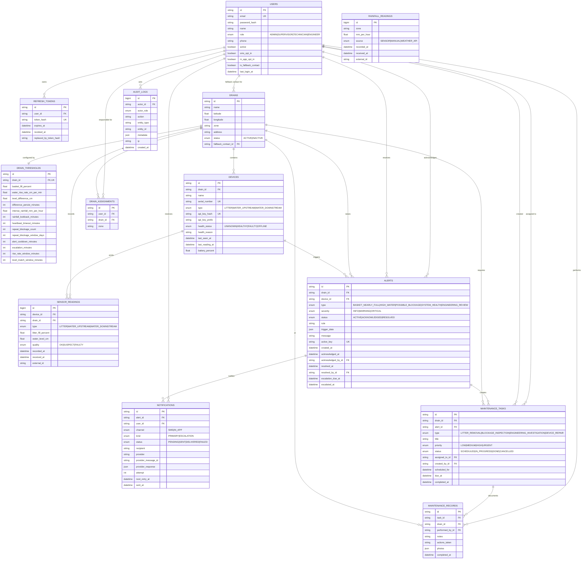

# DrainGuard — Entity Relationship Diagram and Database Schema

Source of truth: [`apps/api/prisma/schema.prisma`](../apps/api/prisma/schema.prisma).
Initial migration: [`apps/api/prisma/migrations/20260101000000_init/migration.sql`](../apps/api/prisma/migrations/20260101000000_init/migration.sql).

PostgreSQL (Neon-compatible), Prisma 6. All timestamps are `timestamptz` in UTC.
Money is not used; sensor values use `double precision`. IDs are `cuid()` strings
except append-only time-series/audit tables, which use `BIGINT` identity keys.

---

## 1. ER diagram



---

## 2. Entity purposes

| Entity | Purpose |
|---|---|
| `users` | Staff accounts and contacts. A user is never hard-deleted while referenced; set `active = false`. |
| `refresh_tokens` | Rotating refresh sessions. Only SHA-256 hashes are stored. |
| `drains` | Physical drain locations with lat/lng, zone and active/inactive status. |
| `drain_thresholds` | Per-drain rules configuration. Created with defaults when a drain is created. |
| `devices` | Sensor nodes: exactly one of each type per drain (enforced). Stores API-key hash, health and heartbeat. |
| `sensor_readings` | Append-only time series from devices. One nullable value column is set according to device type. |
| `rainfall_readings` | Zone-level rainfall time series from gauges, manual entry or a weather API. |
| `alerts` | Rule outcomes with severity, status, triggering rule, trigger data and lifecycle timestamps. |
| `notifications` | One row per delivery attempt (SMS or in-app), including escalation attempts and provider response. |
| `maintenance_tasks` | Work created from alerts or manually. Drives the task board and prioritised inspection list. |
| `maintenance_records` | Completed work logs and engineering findings. |
| `drain_assignments` | Many-to-many responsibility mapping by drain or by zone. |
| `audit_logs` | Append-only audit trail of security and operational actions. |

---

## 3. Key constraints and design notes

### 3.1 Alert de-duplication

- `alerts.active_key` is **nullable and unique**.
- While an alert is open (`ACTIVE` or `ACKNOWLEDGED`) it holds
  `active_key = "<drainId>:<type>"`. On resolution the key is set to `NULL`.
- PostgreSQL allows multiple `NULL`s in a unique index, so arbitrary resolved history
  coexists while at most one open alert per drain/condition remains.
- The API catches Prisma `P2002` on this index and treats it as "already open".
- Cooldown is enforced in the application using the most recent resolved alert for the
  same drain/type; suppressed evaluations are audited.

### 3.2 One device per type per drain

`UNIQUE (drain_id, type)` on `devices` keeps the rules unambiguous: one litter sensor,
one upstream sensor and one downstream sensor per drain. Supporting multiple sensors of
the same type would require a grouping key and an aggregation rule; it is out of scope.

### 3.3 Reading idempotency and ordering

- `UNIQUE (device_id, recorded_at)` makes repeated posts of the same sample idempotent.
- `UNIQUE (device_id, external_id)` allows devices that supply a stable sample id
  (`external_id`) to be deduplicated even if they round timestamps.
- `received_at` captures actual ingest time; `recorded_at` is device time.
- `device.last_reading_at` advances monotonically to `max(existing, recorded_at)`.
- Time-series indexes are descending on `recorded_at` to serve "latest first" queries.

### 3.4 Time series and aggregation

- `sensor_readings` indexes:
  - `(drain_id, recorded_at DESC)`
  - `(device_id, recorded_at DESC)`
  - `(drain_id, type, recorded_at DESC)`
  - `(recorded_at DESC)`
- `rainfall_readings` indexes:
  - `(zone, recorded_at DESC)`
  - `(recorded_at DESC)`
- The API caps raw history windows (7 days) and aggregates older ranges by hour/day in
  SQL, returning a `bucket` timestamp and aggregates rather than raw rows.
- Latest readings for the dashboard use PostgreSQL
  `DISTINCT ON (drain_id, type) ... ORDER BY drain_id, type, recorded_at DESC`, which
  uses the composite indexes above.

### 3.5 Zone-level rainfall

Rainfall is stored by zone (text), not by drain. The rules engine matches
`drain.zone = rainfall_readings.zone` exactly. Zone names are normalised
(trimmed; case preserved) by the API; seed data uses consistent names.

### 3.6 Assignments

`drain_assignments` supports either a specific drain or a whole zone:

```sql
CHECK (drain_id IS NOT NULL OR zone IS NOT NULL)
```

The check is documented here but Prisma does not model check constraints. The API
enforces exactly-one-of validation with Zod. Unique indexes `(user_id, drain_id)` and
`(user_id, zone)` prevent duplicate assignments; Postgres treats `NULL`s as distinct,
so zone rows do not collide with drain rows.

### 3.7 Cascades and deletion policy

| Relation | On delete | Reason |
|---|---|---|
| `refresh_tokens.user_id` | `CASCADE` | Sessions are disposable. |
| `drain_thresholds.drain_id` | `CASCADE` | Configuration belongs to the drain. |
| `drain_assignments.user_id` / `.drain_id` | `CASCADE` | Assignment rows are disposable. |
| `notifications.alert_id` | `CASCADE` | Notification attempts belong to the alert. |
| `maintenance_records.task_id` / `.drain_id` | `RESTRICT` | Work history is immutable. |
| `sensor_readings.device_id` / `.drain_id` | `RESTRICT` | Telemetry is immutable. |
| `alerts.drain_id` | `RESTRICT` | Alert history is immutable. |
| `maintenance_tasks.drain_id` | `RESTRICT` | Work history is immutable. |
| `devices.drain_id` | `RESTRICT` | Devices cannot be orphaned. |
| `alerts.device_id` | `SET NULL` | Keep alert if device is removed. |
| `alerts.acknowledged_by_id` / `.resolved_by_id` | `SET NULL` | Keep alert if user is removed (users are normally deactivated). |
| `maintenance_tasks.assigned_to_id` / `.created_by_id` | `SET NULL` | Keep task history. |
| `notifications.user_id` | `SET NULL` | Keep delivery history. |
| `audit_logs.actor_id` | `SET NULL` | Keep audit history. |

Because of `RESTRICT`, drains and users are **deactivated**, not deleted, once they have
history. The API returns `409 Conflict` with an explanation if a hard delete is unsafe.

### 3.8 Audit trail

`audit_logs` is append-only. It records, at minimum:

- login success/failure, refresh-token reuse, logout
- alert created / acknowledged / resolved / suppressed
- task created / assigned / started / completed / cancelled
- maintenance record created
- drain / device / threshold / user / assignment changes
- device key rotation

`metadata` is JSON with before/after values where safe. Secrets, password hashes, tokens
and API keys are never written to audit logs.

### 3.9 Data retention

- Readings are retained indefinitely by default (time-series indexes keep queries
  efficient). An optional retention job can be added later; v1 does not delete telemetry.
- Alerts, notifications, tasks, records and audit logs are retained for accountability.
- Expired refresh tokens are deleted by a daily cleanup job.

---

## 4. Enum reference

| Enum | Values |
|---|---|
| `Role` | `ADMIN`, `SUPERVISOR`, `TECHNICIAN`, `ENGINEER` |
| `DrainStatus` | `ACTIVE`, `INACTIVE` |
| `DeviceType` | `LITTER`, `WATER_UPSTREAM`, `WATER_DOWNSTREAM` |
| `DeviceHealth` | `UNKNOWN`, `HEALTHY`, `FAULTY`, `OFFLINE` |
| `ReadingQuality` | `OK`, `SUSPECT`, `FAULTY` |
| `RainfallSource` | `SENSOR`, `MANUAL`, `WEATHER_API` |
| `AlertType` | `BASKET_NEARLY_FULL`, `HIGH_WATER`, `POSSIBLE_BLOCKAGE`, `SYSTEM_HEALTH`, `ENGINEERING_REVIEW` |
| `AlertSeverity` | `INFO`, `WARNING`, `CRITICAL` |
| `AlertStatus` | `ACTIVE`, `ACKNOWLEDGED`, `RESOLVED` |
| `NotificationChannel` | `SMS`, `IN_APP` |
| `NotificationStatus` | `PENDING`, `SENT`, `DELIVERED`, `FAILED` |
| `NotificationKind` | `PRIMARY`, `ESCALATION` |
| `TaskType` | `LITTER_REMOVAL`, `BLOCKAGE_INSPECTION`, `ENGINEERING_INVESTIGATION`, `DEVICE_REPAIR` |
| `TaskPriority` | `LOW`, `MEDIUM`, `HIGH`, `URGENT` |
| `TaskStatus` | `SCHEDULED`, `IN_PROGRESS`, `DONE`, `CANCELLED` |

---

## 5. Example `trigger_data`

```json
{
  "rule": "HIGH_WATER_RISE_RATE",
  "deviceId": "dev_water_up_01",
  "deviceType": "WATER_UPSTREAM",
  "readings": {
    "from": { "id": "90121", "waterLevelCm": 18.4, "recordedAt": "2026-10-29T08:02:00.000Z" },
    "to":   { "id": "90140", "waterLevelCm": 42.1, "recordedAt": "2026-10-29T08:12:00.000Z" }
  },
  "spanMinutes": 10,
  "computedRiseCmPerMin": 2.37,
  "thresholdCmPerMin": 2.0,
  "rainfall": {
    "intense": false,
    "latestMmPerHour": 4.2,
    "recordedAt": "2026-10-29T08:10:00.000Z"
  }
}
```

```json
{
  "rule": "BLOCKAGE_SUSTAINED_DIFFERENCE",
  "deviceIds": ["dev_water_up_01", "dev_water_down_01"],
  "differenceCm": 21.6,
  "thresholdCm": 15,
  "sustainedForMinutes": 16,
  "requiredMinutes": 15,
  "pairs": 17,
  "rainfall": {
    "intense": false,
    "latestMmPerHour": 1.0,
    "recordedAt": "2026-10-29T08:10:00.000Z"
  }
}
```

---

## 6. Schema size and performance notes

- 100 drains × 3 devices × 1 reading/minute ≈ 432,000 readings/day. Composite B-tree
  indexes support latest-value and window queries; aggregation prevents large transfers.
- Rule sweeps query only the windows required by thresholds, not full history.
- `alerts.active_key` gives O(1) open-alert checks per drain/type.
- Consider a future TimescaleDB/partitioning migration if deployment grows beyond a
  few million readings per day; v1's indexes and retention policy are sufficient for
  the specified 100+ drain target.
